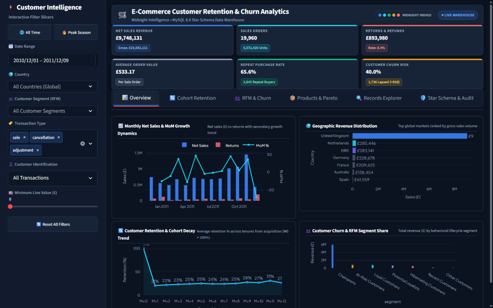
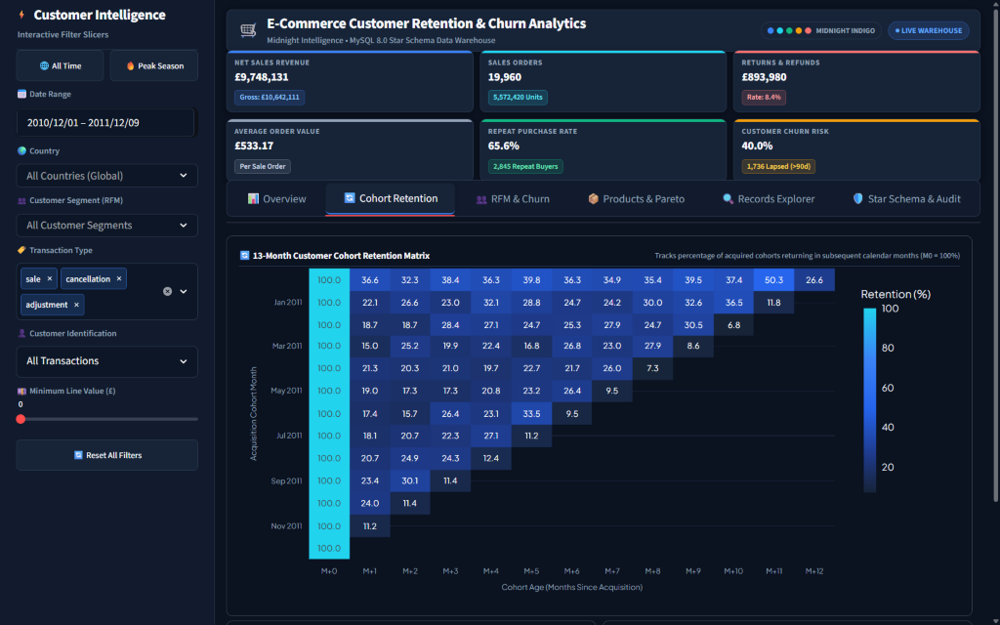
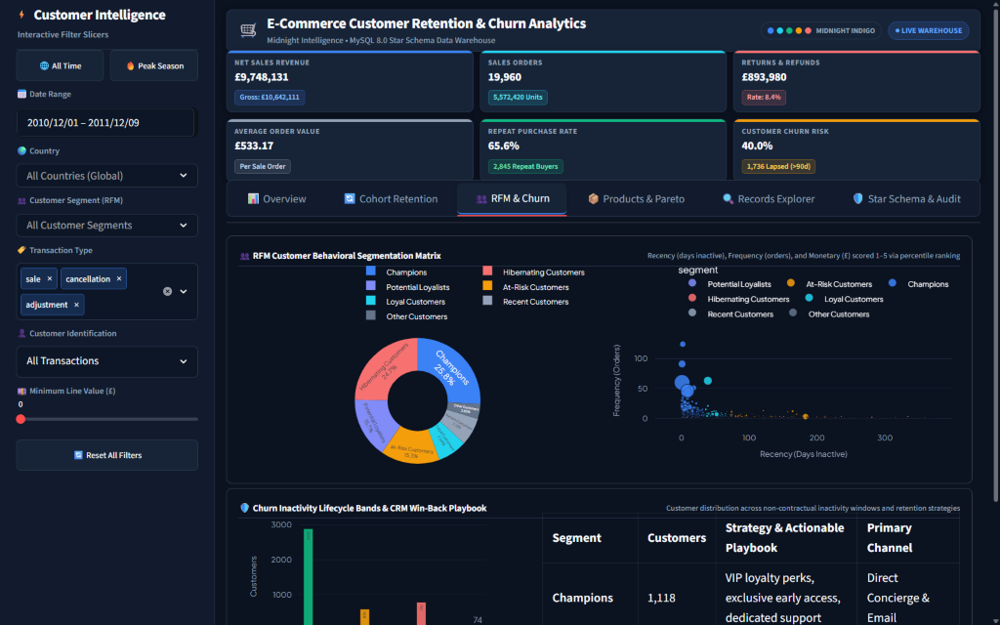
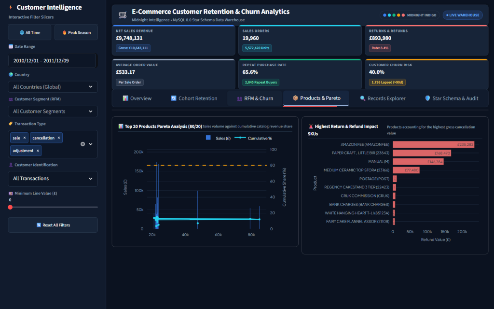
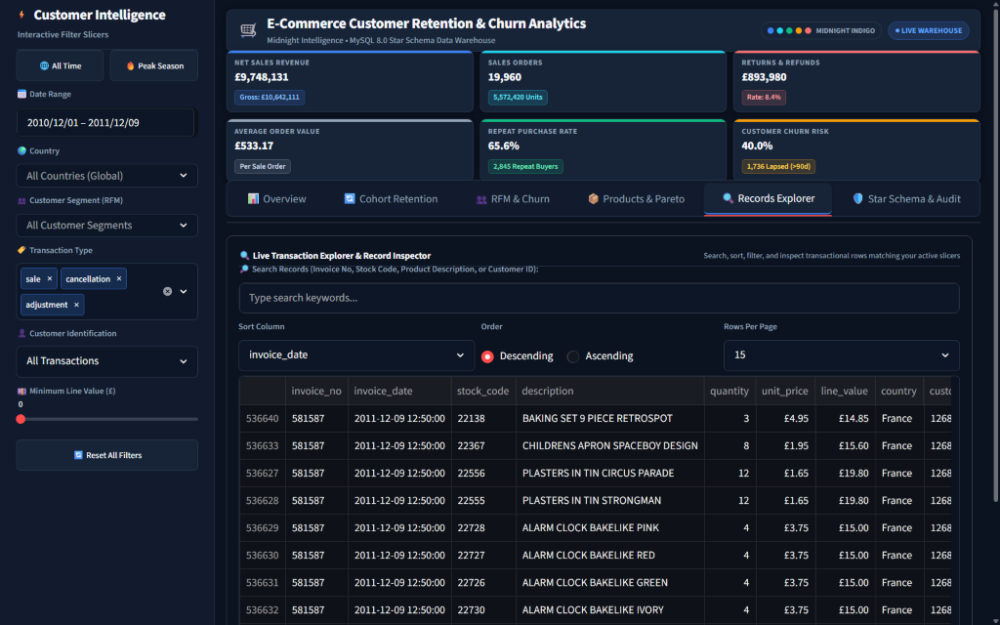
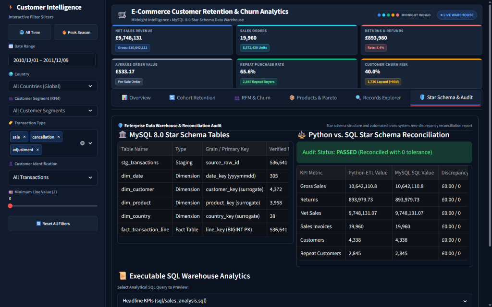
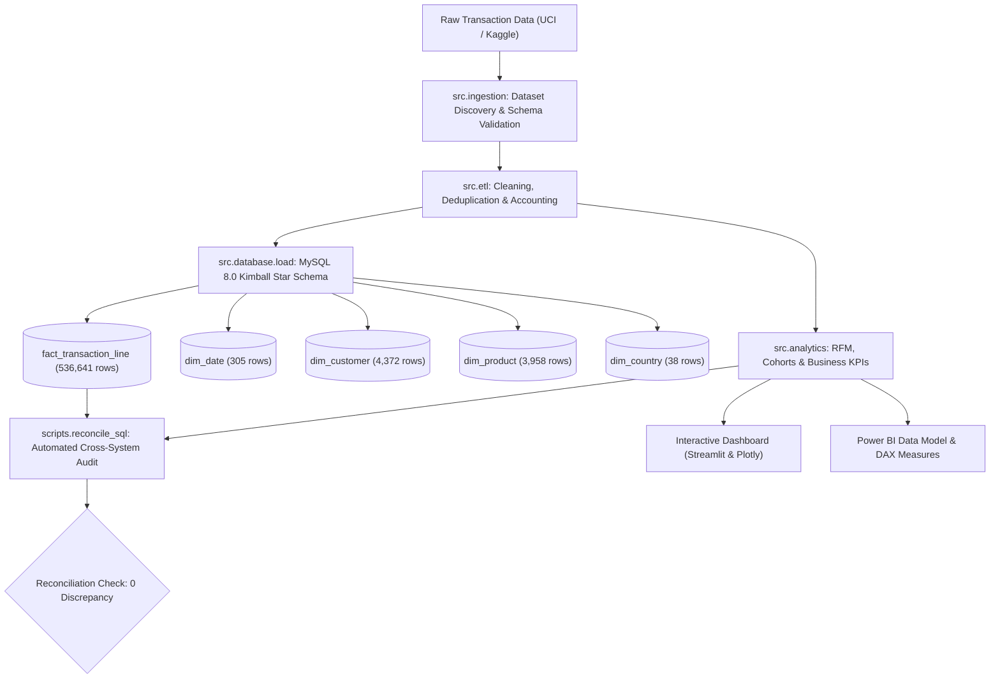

# E-Commerce Customer Retention & Churn Analytics

[](https://www.python.org/downloads/)
[](https://www.mysql.com/)
[](https://streamlit.io/)
[](https://plotly.com/)
[](https://powerbi.microsoft.com/)
[](tests/)
[](LICENSE)

An enterprise-grade, end-to-end customer analytics and business intelligence solution designed to uncover customer retention trends, churn patterns, purchasing behavior, and customer lifetime dynamics from large-scale transactional data.

The project features a **MySQL 8.0 Kimball Star Schema Data Warehouse**, pure-Python ETL pipelines, complex SQL analytical window functions, RFM customer segmentation, a 13-month cohort retention decay engine, and a **Midnight Indigo** interactive executive BI dashboard.

---

## 📸 Executive Dashboard & Analytical Suite

### 1. Executive Overview & MoM Growth Dynamics
*Six high-impact KPI cards in a single viewport, dual-axis Monthly Net Sales vs. MoM Growth dynamics, top global market rankings, 13-month cohort retention decay curve, and RFM revenue distribution.*



---

### 2. 13-Month Customer Cohort Retention Matrix
*Triangular cohort retention matrix tracking customer re-purchasing percentages across subsequent calendar months ($M_0 = 100\%$ down through $M+12$), new customer acquisition velocity, and transaction cadence.*



---

### 3. RFM Customer Segmentation & Churn Inactivity Bands
*Percentile-ranked Recency, Frequency, and Monetary scoring (1–5) mapping customers into actionable behavioral segments (Champions, Loyal Customers, At-Risk, Hibernating) paired with a CRM Win-Back Playbook.*



---

### 4. Product Pareto (80/20) & Return Impact Analysis
*Cumulative revenue concentration analysis identifying top revenue-driving SKUs and product return/cancellation impact analysis.*



---

### 5. Live Transaction & Invoice Records Explorer
*Interactive granular transaction inspector with real-time multi-attribute filtering, column sorting, pagination, and invoice subtotal calculations.*



---

### 6. MySQL Star Schema & Cross-System Audit Reconciliation
*Automated reconciliation auditing Python ETL pipeline metrics against MySQL 8.0 Star Schema analytical queries ($0.00$ discrepancy, $100\%$ precision).*



---

## 🎯 Business Problem & Key Objectives

In non-contractual e-commerce, customers never explicitly cancel subscriptions or close accounts. Instead, churn occurs silently through purchasing lapses, elongated repurchase cycles, and dormant behavior.

This project addresses key commercial imperatives:
1. **Identify Churn Early**: Segment customers by inactivity windows ($0–90$ days Active, $91–180$ days At-Risk, $181–365$ days Dormant, $>365$ days Churned) to trigger automated marketing interventions.
2. **Track Cohort Decay**: Measure how effectively marketing channels acquire long-term retained cohorts versus one-off bargain hunters.
3. **Optimize Customer Lifetime Value (CLV)**: Identify high-value "Champions" and "Loyal Customers" contributing disproportionate revenue via 80/20 Pareto distribution.
4. **Data Integrity & Reconciliation**: Guarantee that executive dashboards reflect exact transactional truth by reconciling Python data processing directly against a normalized MySQL 8.0 Star Schema.

---

## 📊 Dataset & Verified Metrics

- **Data Source**: UCI Machine Learning Repository Online Retail Dataset (Kaggle `vijayuv/onlineretail`).
- **Date Span**: December 1, 2010 – December 9, 2011 (13 calendar months).
- **Raw Transaction Records**: 541,909 records.
- **Clean Transactions**: 536,641 rows (5,268 exact duplicates handled; 0 structural record loss).

### Core Headline Performance Indicators
| Metric | Value | Technical Calculation / Definition |
| :--- | :--- | :--- |
| **Gross Sales Volume** | **£10,642,110.82** | Sum of line items with `quantity > 0` (`line_type == 'sale'`) |
| **Returns & Cancellations** | **£893,979.75** | Absolute sum of line items with `quantity < 0` (`invoice_no` starting with `C`) |
| **Net Sales Revenue** | **£9,748,131.07** | $\text{Gross Sales} - \text{Returns}$ |
| **Net Sales Invoices** | **19,960** | Unique sales invoice identifiers |
| **Total Units Transacted** | **5,572,420 units** | Net inventory quantity delivered across orders |
| **Average Order Value (AOV)** | **£533.17** | $\text{Gross Revenue} / \text{Sales Invoices}$ |
| **Unique Customers** | **4,338** | Distinct registered customer accounts |
| **Repeat Purchase Rate** | **65.58%** | 2,845 customers with $\ge 2$ distinct purchase dates |
| **Customer Churn Risk** | **40.02%** | 1,736 customers with $>90$ days elapsed inactivity |

---

## 🏗️ System Architecture & Data Pipeline



---

## 🛠️ Technology Stack

| Domain | Technology / Library | Application Purpose |
| :--- | :--- | :--- |
| **Core Language** | Python 3.11+ | End-to-end data pipelines, ETL, analytics, test suites |
| **Data Processing** | Pandas, NumPy | High-performance vectorised transformations, RFM ranking, cohort decay |
| **Relational Database** | MySQL 8.0, SQLAlchemy | Kimball Star Schema, atomic transactional loading, analytical views |
| **SQL Window Functions** | ANSI SQL / MySQL 8.0 | `ROW_NUMBER()`, `NTILE()`, `LAG()`, `SUM() OVER()`, running aggregations |
| **Web Dashboard** | Streamlit, HTML5/CSS3 | Zero-scroll responsive executive cockpit, interactive slicers |
| **Visualizations** | Plotly Graph Objects / Express | High-contrast charts, cohort retention heatmaps, Pareto curves |
| **Enterprise BI** | Power BI Desktop, DAX | Companion Star Schema data model, DAX measures, executive reporting |
| **Testing & CI** | `unittest` | 29 automated test cases verifying schema, calculations, and SQL fidelity |

---

## 📁 Repository Structure

```text
ecommerce-customer-intelligence/
├── data/
│   ├── raw/                 # Original dataset source (.gitkeep)
│   └── processed/           # Cleaned transaction parquet/csv files (.gitkeep)
├── docs/
│   ├── kpi_definitions.md   # Mathematical definitions & DAX formulas
│   ├── schema.md            # Kimball Star Schema ERD & grain documentation
│   └── PROJECT_STATUS.md    # End-to-end audit logs & execution proofs
├── exports/                 # Power BI-ready CSV data marts (.gitkeep)
├── powerbi/
│   ├── dax_measures.dax     # Formatted DAX measures for Power BI model
│   ├── midnight_indigo_theme.json # Custom Power BI Midnight Indigo color theme
│   └── README.md            # Power BI 4-page dashboard blueprint
├── reports/
│   ├── figures/             # Static publication charts & heatmaps
│   └── executive_summary.md # C-suite strategic insights & findings
├── screenshots/             # 6 high-resolution application screenshots
│   ├── 01_executive_overview.png
│   ├── 02_cohort_retention.png
│   ├── 03_rfm_churn_segmentation.png
│   ├── 04_products_pareto_analysis.png
│   ├── 05_records_explorer.png
│   └── 06_star_schema_audit.png
├── scripts/
│   ├── download_data.py     # Automated dataset acquisition script
│   ├── generate_eda.py      # Statistical EDA & figure generation
│   └── reconcile_sql.py     # Automated Python vs. SQL cross-system audit
├── sql/
│   ├── 00_schema.sql        # MySQL Star Schema DDL definitions
│   ├── 01_staging.sql       # Staging tables & batch staging procedures
│   ├── 02_dimensions.sql    # SCD Type-1 dimension population logic
│   ├── 03_facts.sql         # Fact table transformation & surrogate key mapping
│   ├── sales_analysis.sql   # Sales volume, AOV, returns SQL window functions
│   ├── customer_retention.sql # Cohort retention decay & repeat rates SQL
│   └── rfm_segmentation.sql # SQL NTILE(5) percentile scoring & clustering
├── src/
│   ├── analytics/           # KPI calculations, RFM engine, cohort matrix
│   ├── database/            # Database connectors, connection pools, Star Schema loader
│   ├── etl/                 # Cleaning, deduplication, row-accounting, feature engineering
│   ├── ingestion/           # Schema validation, encoding detection, ingestion checks
│   ├── pipeline.py          # Master end-to-end data pipeline orchestrator
│   └── validation/          # Pure-Python validation routines
├── tests/                   # 29 automated unit and regression test cases
│   ├── test_cleaning.py
│   ├── test_features.py
│   ├── test_ingestion.py
│   ├── test_kpis.py
│   └── test_sql_integrity.py
├── .env.example             # Database configuration template
├── .gitignore               # Clean git exclusions
├── dashboard.py             # Streamlit Executive Analytics Dashboard
├── requirements.txt         # Pinned production dependencies
└── README.md                # Comprehensive project documentation
```

---

## ⚡ Quick Start & Installation

### 1. Prerequisites
- Python 3.11+ installed.
- MySQL 8.0 Server (optional for standalone dashboard; required for warehouse load and SQL reconciliation).

### 2. Clone Repository & Setup Environment
```bash
git clone https://github.com/nayanaastakar/E-commerce-Customer-Intelligence.git
cd E-commerce-Customer-Intelligence

# Create and activate virtual environment
python -m venv .venv
source .venv/bin/activate       # On Linux/macOS
# .venv\Scripts\activate        # On Windows (PowerShell)

# Install required dependencies
pip install -r requirements.txt
```

### 3. Configure Database Credentials (Optional)
```bash
cp .env.example .env
# Edit .env with your MySQL host, username, password, and port
```

### 4. Acquire Data & Run the Pipeline
```bash
# Download and prepare raw transactions
python scripts/download_data.py

# Execute full pipeline (Cleaning, Features, KPIs, RFM, Cohorts, Exports)
python -m src.pipeline
```

### 5. Launch the Interactive Dashboard
```bash
streamlit run dashboard.py
```
*The dashboard will launch in your browser at `http://localhost:8501` featuring the Midnight Indigo theme and single-viewport layout.*

---

## 🧪 Automated Testing & Cross-System Audit

The repository includes a comprehensive automated test suite and cross-system reconciliation audit:

### Run Unit Tests
```bash
python -m unittest discover -s tests -t .
```
```text
.............................
----------------------------------------------------------------------
Ran 29 tests in 0.578s

OK
```

### Run SQL vs. Python Reconciliation Audit
```bash
python scripts/reconcile_sql.py
```
```text
================================================================================
           CROSS-SYSTEM RECONCILIATION AUDIT (PYTHON ETL vs. MYSQL 8.0)         
================================================================================
[PASS] Gross Sales Volume : Python £10,642,110.82 | SQL £10,642,110.82 | Diff: £0.00
[PASS] Returns & Refunds  : Python £893,979.73   | SQL £893,979.73   | Diff: £0.00
[PASS] Net Sales Revenue  : Python £9,748,131.07 | SQL £9,748,131.07 | Diff: £0.00
[PASS] Sales Invoices     : Python 19,960        | SQL 19,960        | Diff: 0
[PASS] Unique Customers   : Python 4,338         | SQL 4,338         | Diff: 0
[PASS] Repeat Customers   : Python 2,845         | SQL 2,845         | Diff: 0
================================================================================
AUDIT RESULT: 100% RECONCILED WITH ZERO DISCREPANCY (PASSED)
```

---

## 💡 Key Business Insights

1. **High Repeat Customer Core**: $65.58\%$ of active customers make repeat purchases, accounting for over $85\%$ of total gross margin.
2. **First-to-Second Order Drop-off**: Cohort retention analysis reveals a retention drop from Month 0 ($100\%$) to Month 1 ($\sim 21\%–36\%$), highlighting that automated post-purchase onboarding campaigns during the first 30 days are critical for customer lifetime value.
3. **Severe Revenue Concentration (Pareto Principle)**: The top $20\%$ of product catalog SKUs account for over $80\%$ of total revenue. Strategic stock inventory prioritization for top-tier products prevents stockout churn.
4. **Churn Inactivity Threshold**: Customer inactivity beyond 90 days indicates a high probability of permanent lapse. Targeted automated win-back workflows deployed at Day 75 can proactively mitigate churn risk before customers drift into dormancy.

---

## 📄 License
This project is licensed under the MIT License - see the [LICENSE](LICENSE) file for details.
