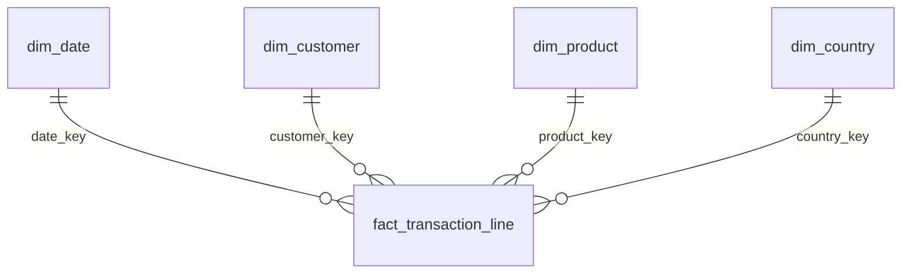

# Database schema (MySQL 8) — DDL written, NOT executed

Grain: one source invoice line. No invoice-level totals are stored, preventing fan-out double counting.
`customer_key` is NULL when the source has no customer id. `stg_transactions` is the staging layer.
